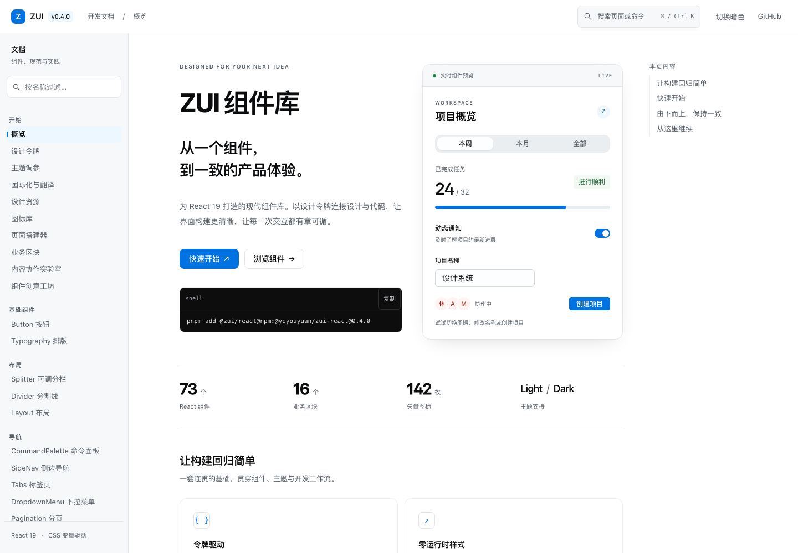
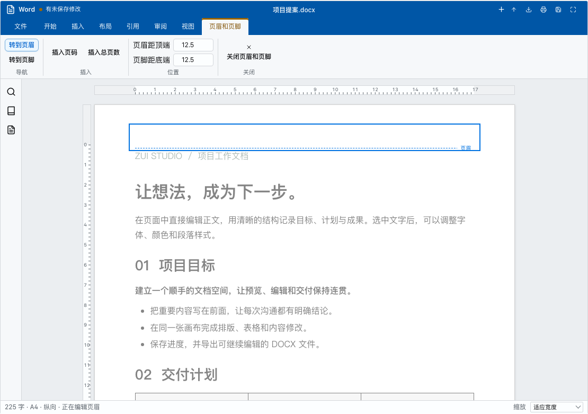
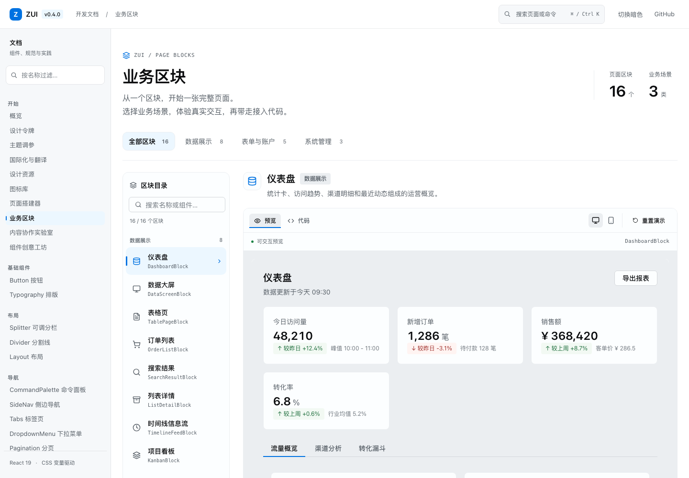

<div align="center">
  <h1>ZUI</h1>
  <p><strong>面向 React 19 的现代组件库与产品界面工具集</strong></p>
  <p>73 个组件、16 个业务区块、OfficeStudio、页面搭建器，以及可供 CLI / MCP 消费的机器可读 Registry。</p>

  <p>
    <a href="https://github.com/yeyouyuan/zui/releases/tag/v0.5.0"></a>
    <a href="https://github.com/yeyouyuan/zui/actions/workflows/ci.yml"></a>
    <a href="https://github.com/yeyouyuan/zui/actions/workflows/pages.yml"></a>
    <a href="./LICENSE"></a>
    
  </p>

  <p>
    <a href="https://yeyouyuan.github.io/zui/"><strong>在线文档</strong></a>
    · <a href="https://yeyouyuan.github.io/zui/#/components/office-studio">OfficeStudio</a>
    · <a href="https://yeyouyuan.github.io/zui/#/builder">页面搭建器</a>
    · <a href="https://yeyouyuan.github.io/zui/#/blocks">业务区块</a>
    · <a href="https://yeyouyuan.github.io/zui/cdn-demo.html">CDN 演示</a>
  </p>
</div>

[](https://yeyouyuan.github.io/zui/)

ZUI 以设计令牌连接设计与代码。组件使用原生 CSS、CSS 变量和语义化定制出口，覆盖常规产品界面、页面级业务场景、文档编辑和可视化页面设计。文档站中的演示可直接操作，截图来自当前 `v0.5.0` 生产站。

## 现在包含什么

| 能力       | 当前范围                                                                 | 入口                                                                                                                                                    |
| ---------- | ------------------------------------------------------------------------ | ------------------------------------------------------------------------------------------------------------------------------------------------------- |
| React 组件 | 73 个 Registry 组件、142 枚图标、10 套语言包                             | [组件文档](https://yeyouyuan.github.io/zui/#/components/button)                                                                                         |
| 业务区块   | 16 个页面级区块，覆盖数据展示、表单与账户、系统管理                      | [业务区块](https://yeyouyuan.github.io/zui/#/blocks)                                                                                                    |
| 文档编辑   | `OfficeEditor` 接入 ONLYOFFICE；`OfficeStudio` 原生编辑 Word、Excel、PDF | [OfficeEditor](https://yeyouyuan.github.io/zui/#/components/office-editor) · [OfficeStudio](https://yeyouyuan.github.io/zui/#/components/office-studio) |
| 页面设计   | 多页、拖拽、图层、响应式样式、主组件、数据源与离线 HTML 导出             | [页面搭建器](https://yeyouyuan.github.io/zui/#/builder)                                                                                                 |
| AI 工具链  | Registry、CLI、MCP、`llms.txt`、机器可读 API 契约                        | [Registry 说明](./registry/README.md)                                                                                                                   |

## 设计取向

| 原则          | 实现                                                                  |
| ------------- | --------------------------------------------------------------------- |
| 令牌驱动      | primitive → semantic → component 三层令牌；CSS 变量负责主题与品牌覆盖 |
| 零运行时样式  | 原生 CSS + `oklch` 色彩，不引入 CSS-in-JS 运行时                      |
| 无障碍优先    | 键盘、焦点、ARIA、窄屏、高对比度和 reduced motion 纳入测试与审计      |
| 稳定定制出口  | `data-part`、slot 级 `classNames`、组件级 CSS 变量，不依赖内部类名    |
| React 19 原生 | ref 直接作为 prop，组合式 API，支持 ESM、CommonJS、SSR 与严格类型声明 |
| AI 友好       | 组件 API、依赖、源码位置与代码生成能力可被 CLI 和 MCP 直接读取        |

## OfficeStudio：在页面内完成真实文档

`OfficeStudio` 使用 ZUI 的按钮、菜单、表单和状态反馈构建独立编辑器，无需文档服务器。它支持真实文件导入导出、打印、浏览器本地恢复和最近 20 次历史版本；需要多人协同与服务端编辑时，可使用 `OfficeEditor` 接入自部署的 ONLYOFFICE Docs。在线文档中的 `OfficeEditor` 临时 Demo 会连接 ONLYOFFICE 官方公共演示服务，并且只加载官方样例文件。

[](https://yeyouyuan.github.io/zui/#/components/office-studio)

- **Word**：正文排版、图片、表格、页眉页脚、页码、查找替换和 DOCX 导入导出。
- **Excel**：多工作表、行列与单元格、合并、冻结、筛选排序、公式、条件格式、数据验证和图表。
- **PDF**：页面缩略图、全文查找、文字与绘图批注、矩形和高亮尺寸调整、普通表单。
- **常规编辑逻辑**：双击页眉或页脚进入上下文功能区，正文暂时锁定；关闭后恢复正文编辑。

能力边界、文件兼容性与宿主适配见 [OfficeStudio 文档](./docs/office-studio.md)；服务版接入见 [OfficeEditor 文档](./docs/office-full-editor.md)。

## 页面搭建器：从组件到可运行页面

页面搭建器覆盖组件目录、多页项目、拖拽与图层、响应式样式、设计变量、交互状态、数据源、主组件与变体、设计检查、版本保存和离线 HTML 导出。导出的页面包含样式与交互，可作为原型离线打开。

[](https://yeyouyuan.github.io/zui/#/builder)

## 业务区块：直接组合完整场景

16 个业务区块提供真实交互和代码查看，包括仪表盘、数据大屏、表格页、订单、搜索、列表详情、时间线、看板、登录、注册、账户设置和系统管理等场景。

[](https://yeyouyuan.github.io/zui/#/blocks)

## 快速开始

### 直接通过 `<script>` 使用

浏览器版已包含 React 和 React DOM，适合演示或没有构建步骤的页面。不要与页面中另一份 React 同时使用。

```html
<link rel="stylesheet" href="https://yeyouyuan.github.io/zui/cdn/v0.5.0/zui.css" />
<div id="root"></div>
<script src="https://yeyouyuan.github.io/zui/cdn/v0.5.0/zui.global.js"></script>
<script>
  ZUI.createRoot(document.getElementById('root')).render(
    ZUI.React.createElement(ZUI.Button, { variant: 'primary' }, '你好，ZUI')
  );
</script>
```

打开 [在线 CDN 演示](https://yeyouyuan.github.io/zui/cdn-demo.html) 查看运行结果。

### 从 GitHub Packages 安装

七个公开包发布在 GitHub Packages。先配置 registry，再使用具有 `read:packages` 权限的 GitHub 账号登录：

```ini
@yeyouyuan:registry=https://npm.pkg.github.com
```

```bash
npm login --scope=@yeyouyuan --auth-type=legacy --registry=https://npm.pkg.github.com
pnpm add @zui/react@npm:@yeyouyuan/zui-react@0.5.0
```

npm alias 会保留源码中的 `@zui/*` 导入路径：

```tsx
import '@zui/react/styles.css';
import { Button, MessageProvider, useMessage } from '@zui/react';

function Demo() {
  const message = useMessage();
  return <Button onClick={() => message.success('操作完成')}>开始使用</Button>;
}

export default function App() {
  return (
    <MessageProvider>
      <Demo />
    </MessageProvider>
  );
}
```

完整登录、别名和七包安装示例见 [GitHub Packages 使用说明](./docs/GITHUB-PACKAGES.md)。当前版本不发布到 npmjs。

## 包与工具链

| 源码导入名    | GitHub Packages 名称    | 说明                                         |
| ------------- | ----------------------- | -------------------------------------------- |
| `@zui/react`  | `@yeyouyuan/zui-react`  | React 组件、样式、OfficeStudio 与浏览器 IIFE |
| `@zui/blocks` | `@yeyouyuan/zui-blocks` | 16 个页面级业务区块                          |
| `@zui/tokens` | `@yeyouyuan/zui-tokens` | CSS 变量、TS 常量、DTCG JSON                 |
| `@zui/icons`  | `@yeyouyuan/zui-icons`  | 142 枚线性 React 图标                        |
| `@zui/i18n`   | `@yeyouyuan/zui-i18n`   | 静态语言包与 `useAutoTranslate`              |
| `@zui/cli`    | `@yeyouyuan/zui-cli`    | `zui init / add / diff / list`               |
| `@zui/mcp`    | `@yeyouyuan/zui-mcp`    | 面向 AI 编码工具的 `search / api / generate` |

## 组件范围

<details>
<summary><strong>查看 v0.5.0 的 73 个组件</strong></summary>

- **基础与录入**：Button、Input、InputNumber、Checkbox、Radio/RadioGroup、Switch、Select、Combobox、MultiCombobox、Cascader、Transfer、Mentions、Form、Rate、Slider、ColorPicker、Upload
- **布局**：Row、Col、Flex、Space、Divider、Splitter
- **导航**：Tabs、Pagination、Breadcrumb、SideNav、CommandPalette、Steps、Anchor、Affix、BackTop、FloatButton
- **浮层与反馈**：Modal、Drawer、Tooltip、Popover、Popconfirm、DropdownMenu、Message、Notification、Tour、Alert、Spin、Progress、Result
- **数据展示**：Table、VirtualTable、Tree、TreeSelect、List、Card、Avatar、Badge、Tag、Empty、Skeleton、Image、QRCode、Watermark、Descriptions、Statistic、Timeline
- **日期与其他**：DatePicker、DateRangePicker、Calendar、TimePicker、Collapse、Segmented、Typography、App
- **文档编辑**：OfficeEditor、OfficeStudio
- **全局配置**：ConfigProvider

</details>

DataGrid 已完成性能原型与 RFC，仍处于正式组件评审阶段。后续组件计划见 [组件路线图](./docs/COMPONENT-ROADMAP.md)。

## 主题与定制

```js
// 暗色主题
document.documentElement.dataset.theme = 'dark';

// 品牌色：只覆盖 semantic 层
document.documentElement.style.setProperty('--z-color-primary', 'oklch(0.55 0.2 150)');
```

```tsx
<Button
  classNames={{ root: 'my-button', label: 'my-button-label' }}
  style={{ '--z-button-radius': '6px' } as React.CSSProperties}
>
  自定义按钮
</Button>
```

组件结构通过 `data-part` 暴露，常规主题和品牌调整无需覆盖内部类名。

## AI、CLI 与 MCP

- `registry/` 保存组件与区块的机器可读 API、依赖和源码位置。
- `zui add <component>` 将组件源码复制到项目，`zui diff` 对比本地与 Registry 版本。
- MCP server 通过 stdio JSON-RPC 提供 `search`、`api`、`generate` 三个工具。
- `@zui/i18n` 的 `useAutoTranslate` 支持 OpenAI 兼容协议、DeepL、有道和自定义 provider，并为失败请求保留静态语言回退。
- `llms.txt` 与 `CONTRACTS.md` 为编码助手提供稳定入口和公共 API 约束。

## 本地开发

```bash
pnpm install
pnpm --filter @zui/docs dev       # http://localhost:5173
pnpm build
pnpm typecheck
pnpm lint
pnpm test
pnpm test:e2e
```

CI 会执行 Registry 校验、全工作区构建与类型检查、ESLint、单元测试、浏览器 E2E、分发入口、消费者安装和 bundle 预算检查。

## 文档

- [在线文档与组件演示](https://yeyouyuan.github.io/zui/)
- [OfficeStudio 能力与兼容性](./docs/office-studio.md)
- [OfficeEditor / ONLYOFFICE 接入](./docs/office-full-editor.md)
- [SSR 与 Next.js](./docs/SSR.md)
- [发布与 GitHub Packages](./docs/GITHUB-PACKAGES.md)
- [版本历史](./CHANGELOG.md)
- [公共 API 契约](./CONTRACTS.md)

## License

[MIT](./LICENSE)
