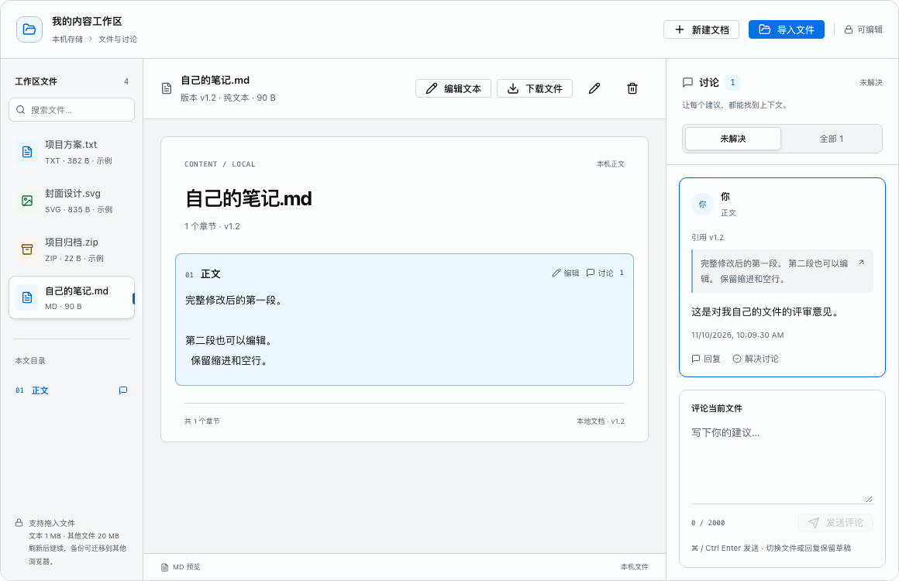

# 内容协作实验室：可用的本地文件工作台

日期：2026-11-10。入口：文档导航“内容协作实验室”（`#/collaboration`）。本轮按用户选择完成本地使用闭环，文件、正文、评论和草稿保存在浏览器 IndexedDB 中。

2026-11-12 更新：Word、Excel、PDF 已接入 [页面内完整编辑器](office-full-editor.md)，打开这些文件时使用本机 ONLYOFFICE 与文件桥接服务。下面保留 2026-11-10 首版本地文本工作台的功能和验证记录；PDF/Office 的当前编辑能力、文件传递及部署以新说明为准。

## 使用流程

1. 点击“导入文件”或拖入本机文件，也可以“新建文档”。初始三份文件明确标为示例，可删除。
2. UTF-8 文本可编辑完整正文；示例文档每个章节都可独立编辑。点击“保存修改”或 ⌘/Ctrl+Enter 更新正文，顶部显示“已保存到本机”后持久保存完成。也可暂存并退出，下次继续草稿。
3. 围绕文件或指定段落评论，可回复、解决和重新打开。署名可在“工作区设置”修改。评论保留时间、引用原文与创建版本，正文变化后仍可定位当前段落。
4. “下载文件”取得编辑后的文本或原始附件。导入和编辑操作创建浏览器内副本，保存不会直接覆盖电脑上的原文件。
5. “工作区设置”可导出完整备份或恢复备份。备份包含文件、附件、正文、评论、回复和草稿；恢复创建独立副本并保留现有文件，可将工作区迁移到其他浏览器。

文件可搜索、重命名和删除，删除前有确认。删除会同时清理该文件的讨论与草稿；空工作区仍可重新创建或导入文件。

## 文件与存储边界

| 项目             | 当前行为                                                                |
| ---------------- | ----------------------------------------------------------------------- |
| 文本             | UTF-8，单文件至多 1 MiB；支持空正文，显示保留空行与缩进                 |
| 文本下载         | 未编辑时保留 UTF-8 BOM 和 CRLF；经过 textarea 编辑后换行使用浏览器的 LF |
| 图片             | 读取真实附件，以图片元素预览；解码失败提供重试和原文件下载              |
| PDF              | 验证文件头，通过浏览器原生 PDF 预览；提供下载供外部阅读器打开           |
| Office、压缩包等 | 保留附件原始字节，提供下载与文件讨论                                    |
| 附件与工作区容量 | 其他单文件至多 20 MiB；工作区至多 100 个文件、文件总量 100 MiB          |
| 数据位置         | 当前浏览器、当前站点来源下的 IndexedDB；附件与工作区记录分开保存        |
| 备份恢复         | 导入本工作台导出的 JSON，验证格式、关联、大小和附件编码；不覆盖现有内容 |
| 只读             | 本页操作模式，保留正文与评论草稿；不是身份认证或服务端权限              |

请持续使用相同预览地址：端口、主机名或浏览器变化后属于不同存储位置。文件不会上传；清理站点数据会删除本机工作区，迁移或清理前应导出备份。

## 保存与冲突

只有 IndexedDB 事务完成后才显示“已保存到本机”。写入失败时，当前内容仍留在页面，可以下载文件、导出备份或重试，界面持续显示失败。尚未持久化时离开页面会触发浏览器确认。

多标签页通过 BroadcastChannel 通知已保存变更；每次事务写入仍校验数据库内的版本标识，不依赖广播正确性。旧标签页修改触发冲突后保留当前数据、停止覆盖，可以先导出当前备份，再明确确认载入最新版本。

## 验证与证据

- 全站浏览器回归：**100/100 通过（1.7m）**，包括 78 个导航页面在 1440/320px、浅色/暗色下的四组显示检查。
- 最终补充编辑后的工作区总容量校验和冲突时的文件切换保护后，协作页再次 **24/24 通过（28.2s）**；Docs TypeScript、修改的代码文件 ESLint、GitHub Pages 生产构建和 `git diff --check` 均通过。
- 协作页包含 **24 条用例**，覆盖真实 UTF-8 文件导入、BOM/CRLF 下载、完整编辑、关闭页面后恢复、任意章节编辑、草稿恢复、新建/重命名/搜索/删除/空工作区、跨浏览器会话备份恢复、错误编码与超限文件、模拟存储失败及重试、多标签页冲突、真实 PDF 与二进制附件下载。
- 响应式检查覆盖 1440、1280、768、320px 的明暗主题，并检查阅读、评论关联、正文编辑状态的 axe 与横向溢出。
- 截图由 Playwright 生成，人工复核桌面与 320px 暗色工作台；本轮未使用浏览器连接器进行手动验收。输入法用例使用组合事件模拟，不替代真实中文输入法验收。

[桌面工作台](audits/2026-11-10/collaboration-local/desktop-workspace.png)、[320px 暗色编辑](audits/2026-11-10/collaboration-local/mobile-dark-editor.png)。

## 实现位置

- `docs/src/pages/collaboration/workspace-model.ts`：文件、正文、讨论、草稿与容量边界。
- `docs/src/pages/collaboration/workspace-store.ts`：IndexedDB、保存状态、附件、冲突与标签页同步。
- `docs/src/pages/collaboration/workspace-backup.ts`：完整备份导出、校验与恢复。
- `docs/src/pages/collaboration/CollaborationPage.tsx`：文件操作、实际预览、编辑及评论界面。
- `e2e/collaboration.spec.ts`：交互、持久化、失败恢复与显示验收。

本次完成文档站本地工作台。FilePreview、ContentEditor、CommentThread 的公共接口仍为 [RFC-006](rfcs/content-collaboration.md) 提案，正式组件数保持 71；多人共享、远端存储、富文本与 Office 转换未包含在这次本地使用范围内。
