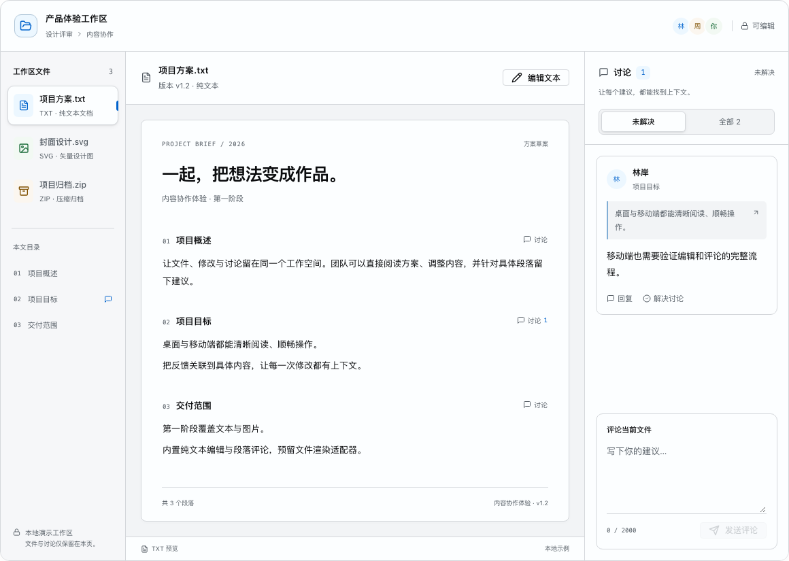
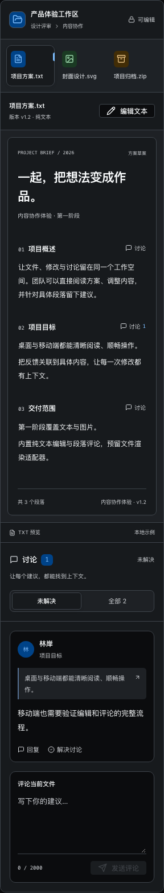
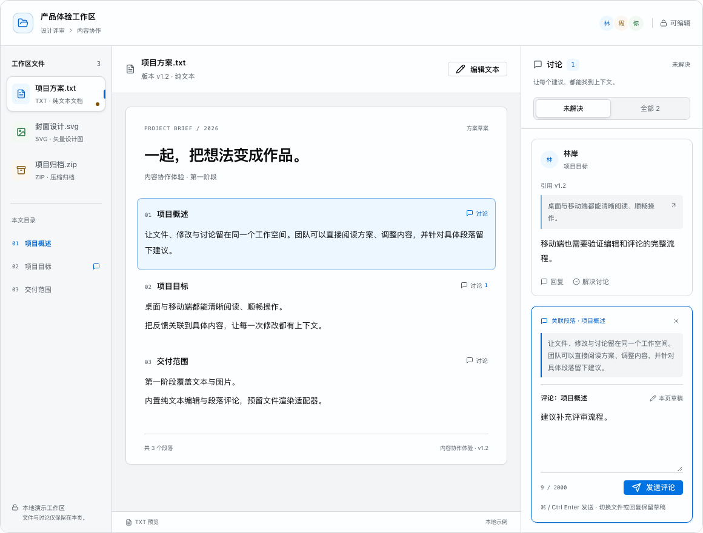
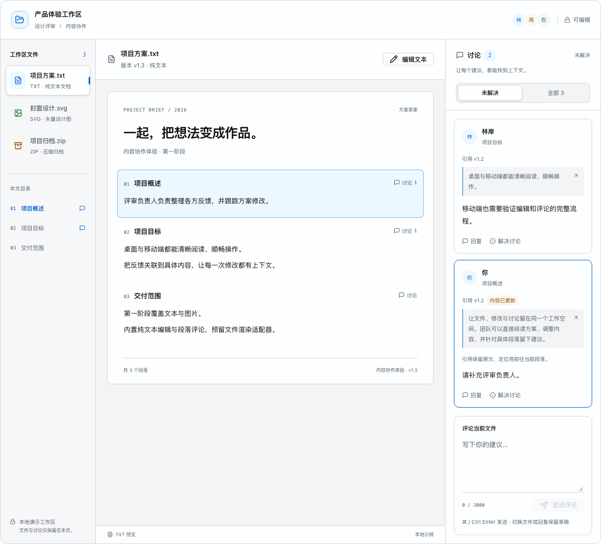

# 内容协作实验室界面优化

日期：2026-11-10。入口：文档导航“内容协作实验室”（`#/collaboration`）。以下保留界面优化及交互原型阶段的历史记录，当时数据只在页面内存中。后续已补齐真实文件操作与 IndexedDB 持久保存，当前能力和验证见[本地文件工作台记录](collaboration-local-2026-11-10.md)。

## 界面与交互

- 扩展工作台宽度，桌面采用文件与目录、文档画布、讨论三栏。工作台容器变窄后依次切换为顶部文件条和双栏、文档与讨论上下排列。
- 页头收紧为标题、简短介绍和协作流程。将演示权限与预览状态选择收进“演示设置”。
- 文件列表增加类型图标、描述和选中标识。本文目录可定位并聚焦正文段落，显示存在未解决讨论的位置。
- 预览采用纸张式文档，重新整理标题、版本、段落、讨论入口与页脚层级。统一图片、加载、失败与不支持类型的展示。
- 讨论采用筛选条、引用卡片和独立输入区。从段落发起讨论或回复时显示关联上下文，可取消关联并返回文件评论输入区；解决线程后焦点回到“未解决”筛选。
- 保留编辑、取消、快捷保存、引用快照、回复、解决/重新打开、文件隔离与只读行为。成员头像明确标为演示成员。

## 验证

| 检查              | 结果                                                                                                      |
| ----------------- | --------------------------------------------------------------------------------------------------------- |
| 协作页浏览器用例  | 11/11 通过：原有 3 条交互用例加 8 组响应式与完整 axe 检查                                                 |
| 响应式矩阵        | 1440、1280、768、320px，分别覆盖浅色与暗色；检查列数、横向溢出、评论关联、设置开合与焦点                  |
| 全站显示矩阵      | 78 页 × 1440/320px × 浅色/暗色，共 312 次检查，布局与文字对比度问题均为 0                                 |
| 全站浏览器回归    | 86/87 通过；唯一失败为 DataGrid 列宽更新计时 81.5ms，超过既有 64ms 预算                                   |
| DataGrid 独立复核 | 保持原预算与实现，单进程连续 3 次通过，计时为 0.3、38.6、38.4ms；保留并发计时波动记录，不视为同次全量全绿 |
| 静态与构建        | Docs TypeScript、修改文件 ESLint、GitHub Pages 生产构建、`git diff --check` 通过                          |
| 人工截图复核      | 桌面浅色、1280px 暗色、320px 暗色完整工作台；另在本机预览确认界面与设置面板开合                           |

全站标题检查改为识别专用 `h1.doc-h1`，允许标题位于语义页头内；仍要求文档主标题唯一，嵌入的业务区块预览不计入主标题。

显示矩阵摘要保存在 [matrix-summary.json](audits/2026-11-10/collaboration-ui/matrix-summary.json)。完整临时报告与逐页截图位于 `/tmp/zui-collaboration-ui-audit/`，该目录不保证长期保留。浏览器矩阵不替代真实辅助技术、中文输入法及原生缩放人工验收。

## 截图

完整文档外壳：[桌面浅色](audits/2026-11-10/collaboration-ui/desktop-light.png)、[桌面暗色](audits/2026-11-10/collaboration-ui/desktop-dark.png)、[1280px 暗色](audits/2026-11-10/collaboration-ui/compact-dark.png)。

## 同日交互补充

- 分开管理阅读定位与评论关联：点击目录或旧引用只移动阅读焦点，输入中的评论保持原目标。从段落的“讨论”按钮进入评论时，输入区明确展示段落名称、引用内容和取消定位入口。
- 按文件、段落和回复线程分别保留评论草稿；切换回来可以继续输入。取消定位或回复、发送成功后返回原有文件评论草稿，发送只清除本次草稿。文件增加未发送草稿圆点，输入区标注“本页草稿”。只读模式保留评论草稿并禁用输入，刷新会重置。
- 引用记录创建版本。被引用文本修改后保留原文，显示“内容已更新”及说明，定位仍前往当前段落；修改其他段落不会误标记。加载或失败状态下禁用无法执行的定位操作。
- 评论支持 ⌘/Ctrl+Enter 发送，发送后保留输入焦点；组合输入事件不触发发送。演示设置支持点击外部收起、Escape 收起并归还焦点。
- 正文编辑区整理标签、字符数、快捷键和帮助信息；保存与取消按钮明确区分，降低编辑段落底色强度，精简评论输入区的焦点描边。

协作页定向回归为 **16/16 通过（15.0s）**：保留原有 11 条并新增 5 条草稿、引用与键盘交互用例。8 组宽度/主题组合同时检查带引用的评论输入区和正文编辑状态，执行完整 axe 与横向溢出检查。这一轮只重跑协作页，之前的 86/87 全量回归与 DataGrid 独立复核记录保持有效，不代表当前 92 条全量用例已全部复跑。

本轮截图来自 Playwright，已复核桌面编辑、手机暗色评论上下文及引用更新状态；未新增手动浏览器连接器验收。

补充验证：Docs TypeScript、修改文件 ESLint、GitHub Pages 生产构建及 `git diff --check` 均通过。

其他验收截图：[桌面编辑状态](audits/2026-11-10/collaboration-ui/followup/desktop-editor.png)、[320px 暗色评论上下文](audits/2026-11-10/collaboration-ui/followup/mobile-dark-comment-context.png)、[320px 暗色编辑状态](audits/2026-11-10/collaboration-ui/followup/mobile-dark-editor.png)。

## 边界

本次没有增加正式包导出或 Registry 条目，正式组件仍为 71 个。FilePreview、ContentEditor、CommentThread 的通用接口仍为 [RFC-006](rfcs/content-collaboration.md) 提案。后续本地工作台已实现异步保存、失败重试、冲突和持久化；权限服务与实时协同仍不在本地工作台范围内。
