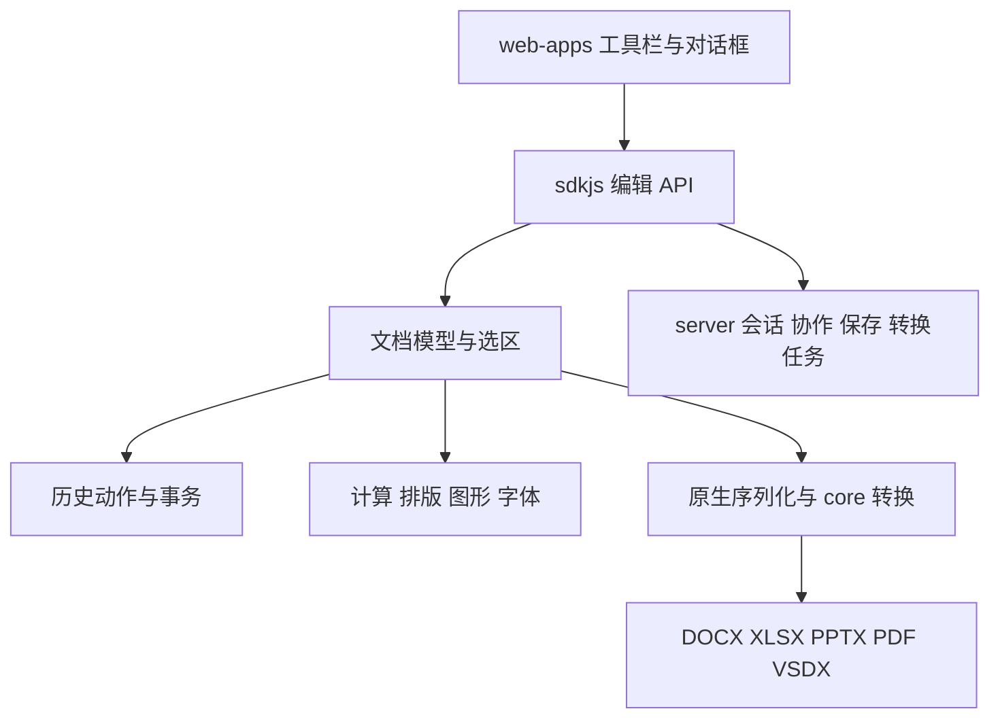

# ONLYOFFICE 源码梳理与逐项实现计划（2026-11-13）

已获取 ONLYOFFICE Docs 五个主要仓库的完整 Git 文件树，并完成所有已跟踪编程源文件的文本扫描、模块统计、SDK 方法与 UI 调用点索引。首版拆成 **196 个功能条目**，每项记录源码、当前差距、阶段与验收要求，见 [逐项功能台账](onlyoffice-feature-ledger-2026-11-13.md) 和 [JSON 台账](onlyoffice-feature-ledger-2026-11-13.json)。

这里的“全量扫描”指读取文件并建立索引，**不等于逐行理解 662 万行源码，也不等于运行验证了全部功能**。目前精读了下表中的关键链路；其余条目定位了入口或候选调用点，后续实现前继续读取对应命令、模型、历史与序列化。196 是首版功能分组数，公式、图形类型和对话框细节还需进一步展开，不能作为 ONLYOFFICE 功能总数。

## 源码范围与固定版本

| 仓库                                                           | 固定提交                                   | 跟踪文件 | 编程源码行数 | 作用                                             |
| -------------------------------------------------------------- | ------------------------------------------ | -------: | -----------: | ------------------------------------------------ |
| [web-apps](https://github.com/ONLYOFFICE/web-apps)             | `f79972a400c3a696490094961772d1f86fac1b82` |   33,000 |      876,444 | 五类编辑器界面、工具栏、对话框、快捷键、宿主 API |
| [sdkjs](https://github.com/ONLYOFFICE/sdkjs)                   | `9d2138866d929be32f1d107e8b5bfae36156e097` |    1,097 |    1,444,592 | 文档模型、计算、布局、历史、图形与编辑命令       |
| [core](https://github.com/ONLYOFFICE/core)                     | `ed63e94de814ff1d4ea28cddfaba6939bc9df9ed` |   21,117 |    4,255,264 | 原生格式读写与转换、字体度量、图像与渲染         |
| [server](https://github.com/ONLYOFFICE/server)                 | `f037d2c42fab6ef627f323bd8f8f73b4f99b0cd0` |      267 |       47,916 | 会话、协作、保存、转换任务与服务配置             |
| [DocumentServer](https://github.com/ONLYOFFICE/DocumentServer) | `c4ad98db9f0dd84a9949566de399fc79698acd46` |       14 |           16 | 产品组合、Git 子模块与构建入口                   |

总计 **55,495 个跟踪文件、16,878 个编程源文件、6,624,232 行**，扫描时未落盘的编程源文件为 0。统计包含仓库内的第三方源码；模板、样式、资源等归入文件树，不计入编程源码行数。索引记录了 3,316 个 SDK 方法定义、4,206 个 UI API 调用点和 506 个公式构造器记录。方法中包含 getter、包装与空实现；构造器记录包含兼容声明，均不能直接当作可执行功能数量。

DocumentServer 的 web-apps/sdkjs Git 子模块提交与本次保留的研究快照不同；core/server 一致。因此这五个提交是分别固定的参考快照，**没有组成并验证一个统一发布版本**。字体、词典、模板、插件仓库属于独立依赖，本次没有声称读完这些仓库或 ONLYOFFICE 全公司的其他产品。

机器记录见 [源码索引](onlyoffice-source-inventory-2026-11-13.json)。本机完整参考位于 `/tmp/zui-onlyoffice-reference-20261112/`；可通过 `python3 scripts/inventory-onlyoffice-source.py SOURCE_ROOT OUTPUT_JSON` 重建扫描。固定提交和定位信息保存在仓库文档中，临时目录不作为长期交付依赖。

## 架构与关键链路

| 已精读链路            | 源码证据                                                                                                                                                                                                                                                                                                                                                                                             | 对自研实现的约束                                                                                                                                                      |
| --------------------- | ---------------------------------------------------------------------------------------------------------------------------------------------------------------------------------------------------------------------------------------------------------------------------------------------------------------------------------------------------------------------------------------------------- | --------------------------------------------------------------------------------------------------------------------------------------------------------------------- |
| Excel 选择性粘贴      | [公共粘贴菜单](https://github.com/ONLYOFFICE/web-apps/blob/f79972a400c3a696490094961772d1f86fac1b82/apps/common/main/lib/controller/PasteOptions.js#L125)、[SDK 入口](https://github.com/ONLYOFFICE/sdkjs/blob/9d2138866d929be32f1d107e8b5bfae36156e097/cell/api.js#L475)、[属性掩码](https://github.com/ONLYOFFICE/sdkjs/blob/9d2138866d929be32f1d107e8b5bfae36156e097/cell/model/clipboard.js#L69) | 仅公式同时粘贴常量；仅值写入公式结果；仅格式保留目标值和链接；无边框保留目标边框。值、公式、数字格式、其他格式、列宽分别控制                                          |
| Excel 批量历史与重算  | [History 事务](https://github.com/ONLYOFFICE/sdkjs/blob/9d2138866d929be32f1d107e8b5bfae36156e097/cell/model/History.js#L1474)                                                                                                                                                                                                                                                                        | 一次操作内暂停依赖重算，事务结束恢复。自研批量命令需先验证整个修改，再一次提交与撤销                                                                                  |
| Excel 透视表创建      | [创建入口](https://github.com/ONLYOFFICE/sdkjs/blob/9d2138866d929be32f1d107e8b5bfae36156e097/cell/api.js#L7717)、`cell/model/PivotTables.js`                                                                                                                                                                                                                                                         | 包含来源验证、工作表创建、透视对象、缓存和事务。必须先有结构化数据与文件契约                                                                                          |
| Word 脚注、排版与动作 | [脚注 API](https://github.com/ONLYOFFICE/sdkjs/blob/9d2138866d929be32f1d107e8b5bfae36156e097/word/api.js#L5400)、[正文插入](https://github.com/ONLYOFFICE/sdkjs/blob/9d2138866d929be32f1d107e8b5bfae36156e097/word/Editor/Document.js#L19165)、[文档动作](https://github.com/ONLYOFFICE/sdkjs/blob/9d2138866d929be32f1d107e8b5bfae36156e097/word/Editor/Document.js#L2022)                           | 检查正文位置、数学区和锁，再创建引用与注释、重排和结束动作。脚注必须参与分页。Word 使用文档动作，不能套用 Excel 事务；其历史 StartTransaction/EndTransaction 有空实现 |
| Word 格式刷与大小写   | [格式刷](https://github.com/ONLYOFFICE/sdkjs/blob/9d2138866d929be32f1d107e8b5bfae36156e097/word/api.js#L8880)、[文本转换](https://github.com/ONLYOFFICE/sdkjs/blob/9d2138866d929be32f1d107e8b5bfae36156e097/word/api.js#L13082)                                                                                                                                                                      | 格式刷有单次/连续状态、互斥工具与退出；复制字符和段落格式。大小写修改委托文档内核，需保持结构和选区                                                                   |
| Word 目录与修订       | [目录 API](https://github.com/ONLYOFFICE/sdkjs/blob/9d2138866d929be32f1d107e8b5bfae36156e097/word/api.js#L11960)、`Document.js` 的目录生成和修订方法                                                                                                                                                                                                                                                 | 自动目录是生成域和内容控件，依赖页码及布局；大纲导航只提供标题索引。修订需记录插入、删除、格式、作者和时间                                                            |
| PDF 页面操作          | [页编辑/插入/删除](https://github.com/ONLYOFFICE/sdkjs/blob/9d2138866d929be32f1d107e8b5bfae36156e097/pdf/api.js#L820)、`pdf/src/document.js`                                                                                                                                                                                                                                                         | 有多页选区、锁、页面与批注引用迁移，禁止删除所有页面；保存后对象引用保持正确                                                                                          |
| PDF 原页面内容编辑    | [EditPage 内核](https://github.com/ONLYOFFICE/sdkjs/blob/9d2138866d929be32f1d107e8b5bfae36156e097/pdf/src/document.js#L6406)                                                                                                                                                                                                                                                                         | 通过原生 scanPage 生成可编辑文字/绘图，映射字体与图片。当前 PDF.js 渲染加覆盖标注不足以实现原文编辑                                                                   |
| PDF 脱敏              | [脱敏命令](https://github.com/ONLYOFFICE/sdkjs/blob/9d2138866d929be32f1d107e8b5bfae36156e097/pdf/api.js#L1567)、`pdf/src/document.js` 的 ApplyRedact                                                                                                                                                                                                                                                 | 实际删除内容和相关资源；画不透明矩形不能标为完成脱敏                                                                                                                  |
| PPT 切换与内核划分    | [切换入口](https://github.com/ONLYOFFICE/sdkjs/blob/9d2138866d929be32f1d107e8b5bfae36156e097/slide/api.js#L8162)、`slide/Editor/Format/Presentation.js`                                                                                                                                                                                                                                              | 母版、版式、对象动画、切换与演讲者视图各有模型，需要独立 PPTX 编辑器                                                                                                  |
| 原生转换与服务        | `core/X2tConverter/src/ASCConverters.cpp`、`core/OOXML/{DocxFormat,XlsxFormat}`、`core/DesktopEditor/fontengine/FontManager.cpp`、`server/DocService/sources/{DocsCoServer,converterservice,canvasservice}.js`                                                                                                                                                                                       | 文件兼容与字体度量属于内核；协作、转换任务属于服务。当前只推进独立编辑器与标准宿主接口，不增加后端                                                                    |

本次核实修正了 51 个条目的源码引用，包括原 API 拼写 `ClearFormating`、表格边距/标题行属性、公式模型、文档比较和历史事务。其余自动索引仍是候选入口，完整语义需在对应功能实施时继续确认。

## 功能地图与当前差距

| 产品   | 条目 | 功能范围                                                                                                           |
| ------ | ---: | ------------------------------------------------------------------------------------------------------------------ |
| Word   |   65 | 字符、段落、样式、表格、图片与图形、页面/分节/分页、引用域、查找、批注/修订、表单                                  |
| Excel  |   68 | 剪贴板与选择性粘贴、选区/填充、单元格格式、行列工作表、公式/名称、数据规则、结构化表、透视、图表、视图、打印、保护 |
| PDF    |   26 | 阅读搜索、页面管理、原文编辑、自由文本、图形与批注、表单、脱敏、权限和证书签名                                     |
| PPT    |   18 | 幻灯片、主题/母版、文本/图形/表格/媒体、切换/动画、放映、演讲者视图、文件导出                                      |
| 流程图 |    3 | VSDX 文件、多页导航、几何/主题/连接/形状数据；条目是待进一步展开的模块分组                                         |
| 公共   |   16 | 文件生命周期、历史、主题/缩放、输入/辅助功能、协作/权限、插件/宏、字体、图形与序列化                               |

当前状态：基础已有 24 项、部分 55 项、缺失 93 项、未提供对应编辑器 21 项、宿主依赖 3 项。X003–X010 已完成本地实现和专项测试；“基础已有”仍需按该项细节继续做真实浏览器与文件往返验收。当前最大缺口是 Word 分页和结构内核、Excel 高级数据对象、PDF 内容编辑，以及 PPT 编辑器，不能靠扩展按钮数量解决。

## 实施队列与依赖

1. **Excel 剪贴板完整数据及选择性粘贴（X003–X010，本地实现完成）**：内部复制冻结单元格、计算值、格式、列宽、合并和超链接快照；支持公式、值、格式、数字格式组合、源格式、无边框、列宽与转置，目标验证通过后一次提交。后续继续验收真实浏览器及复杂 XLSX 往返；链接图片/条件规则、跳过空格和运算仍归 X011–X012。
2. **Word 日常编辑（W002、W006–W009、W012、W014、W018）**：字号阶梯、高亮、大小写、格式刷、清除格式、段落间距、编号与非打印字符，逐项核对选区及 DOCX 往返。
3. **Excel 数据和打印（X034、X043–X048、X065）**：名称管理、多条件排序/筛选、分列、重复项、验证/条件格式管理、打印区域和重复标题。
4. **PDF 页面管理（P004–P007）**：插入、删除、复制/移动、旋转，先建立稳定页面身份与引用迁移，再接入导出。
5. **Word 结构与分页（W027、W033、W041–W046、W050–W055）**：先定义节、锚点、域、注释和分页模型，再做页眉页脚、目录、脚注和交叉引用；真实分页是依赖门槛。
6. **Excel 结构化表与透视（X035–X036、X050–X056）**：先完成表身份、结构引用、缓存与原生文件关系，再做字段布局、汇总、筛选、钻取和切片器。
7. **审阅、高级图形及新编辑器**：修订/比较、图形和公式排版、PDF 内容编辑/脱敏、PPT；每个对象必须具有实际编辑内核和原生保存能力。

公式单独从构造器索引进一步建立“函数名—参数—类型转换—数组—错误—精度—文件缓存”的测试清单，按函数验收，不能用第三方计算库提供了相同名字作为完成证据。

每个功能的完成记录包含：源码行为摘要、实际 ZUI 入口、数据与格式结果、选择/焦点/IME/取消、一次撤销与重做、只读与异常、原生保存重开、针对性测试和浏览器验收。只完成一部分时保留“部分”，明确尚未支持的对象或边界。当前台账没有把待做项标成已对齐。
