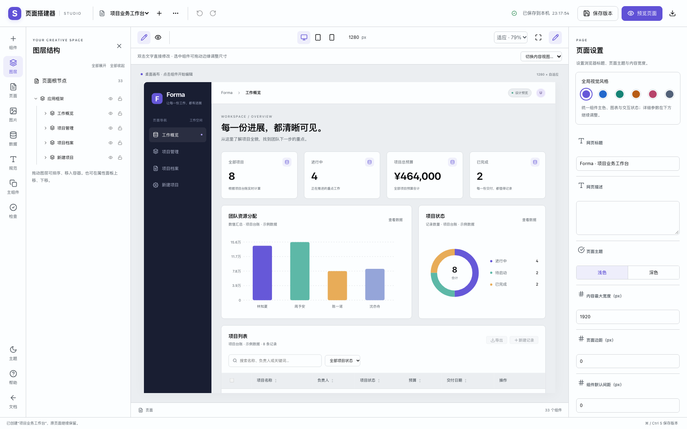
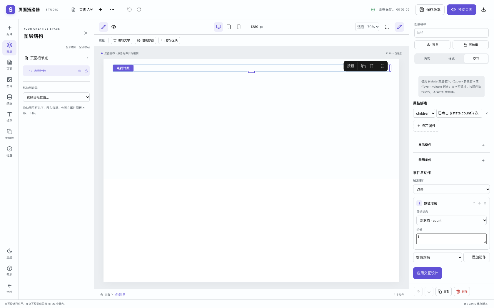
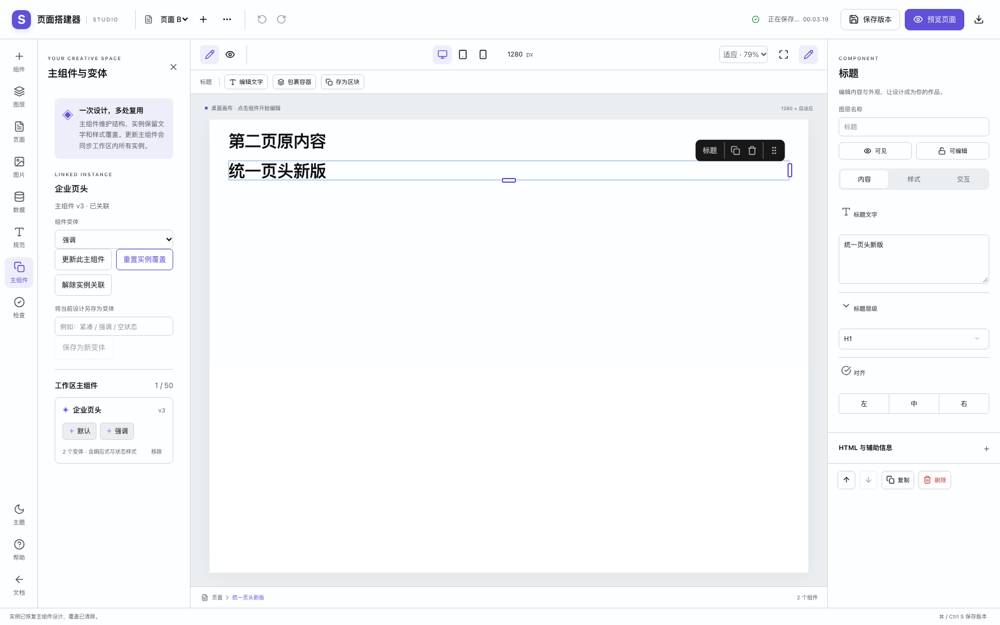
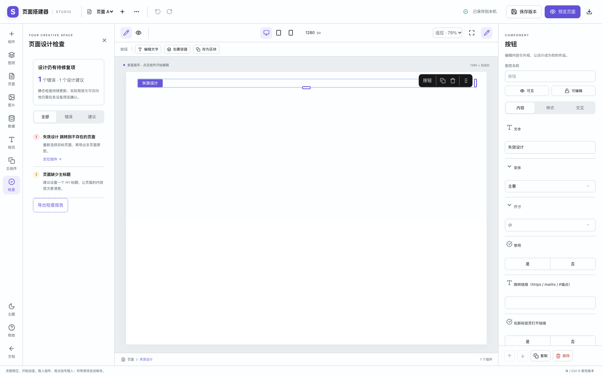

# 页面设计器：设计规范、组件复用与交互原型

日期：2026-11-10。入口：文档站「页面搭建器」，路由 `#/builder`。

本轮继续完善页面设计能力。现有 89 个搭建节点、71 个公开 ZUI 组件目录、10 套整页模板和 15 个预设区块继续可用。企业 API 与统一登录尚未确定，保留现有标准数据源接口；新增能力均在前端与本机工作区运行。

## 从哪里开始

1. 在顶部「新建页面」选择模板。业务系统可从「项目业务工作台」「运营分析看板」「内容资源中心」开始；官网与信息收集可使用「品牌产品官网」「需求收集门户」。
2. 在「组件」拖入或插入 ZUI 组件，在「图层」调整嵌套、顺序、锁定与隐藏。双击画布文字直接编辑；使用桌面、平板、手机画布分别调整布局。
3. 在「规范」加入基础设计变量，再绑定组件颜色、间距、圆角与字号。右侧样式面板可以单独设计悬停、聚焦、按下与禁用状态。
4. 在「主组件」创建重复使用的组件及变体。跨页插入关联实例，保留页面自身的文字和样式覆盖。
5. 选中组件后，在属性面板「交互」配置状态、属性绑定、显隐、禁用条件与事件动作。
6. 在「检查」定位设计问题；从「页面」预览整个工作区的跳转，或通过文件菜单导出多页面交互原型与工作区备份。

## 本轮新增与修复

| 能力         | 可实际执行的操作                                                                                                            |
| ------------ | --------------------------------------------------------------------------------------------------------------------------- |
| 多选与布局   | Shift 点选图层或画布、Cmd / Ctrl + A、批量样式、复制、删除、横向 / 纵向 / 栅格分组、自由布局、对齐和等距分布                |
| 自由布局适配 | 按画布实际坐标组合选区；手机覆盖改为流式布局；锁定选区拒绝整项批量操作，避免部分修改                                        |
| 设计变量     | 颜色、间距、圆角、字号四类命名变量，基础规范、属性绑定、跨页同步，导出保留 CSS 变量引用                                     |
| 组件状态     | 桌面 / 平板 / 手机分别配置 hover、focus、active、disabled 样式；画布可强制预览，导出后真实响应状态                          |
| 主组件       | 工作区组件库、关联实例、跨页同步、实例覆盖、更新主组件、重置覆盖、解除关联                                                  |
| 组件变体     | 创建和切换变体，保留实例文字及样式覆盖；允许本地新增子节点，更新时保留                                                      |
| 交互设计     | 页面状态变量、类型化属性绑定、条件显隐 / 禁用，以及点击、值变化、表单提交事件                                               |
| 动作序列     | 状态赋值 / 增减 / 重置、条件与确认分支、提示、多页跳转、文本下载、只读数据源刷新                                            |
| 多页原型     | 页面选择、Hash 路由、浏览器后退、不存在页面提示，独立 HTML 内包含页面数据及运行时                                           |
| 设计检查     | 配置错误、缺失状态或设计变量、失效页面 / 主组件 / 数据字段、重复锚点、缺少辅助说明、固定宽度窄屏风险；可定位组件并导出 JSON |
| 保存与导入   | 旧版存档兼容；独立区块携带数据源、规范与状态依赖；工作区导入重写页面、主组件和历史快照引用，保留已有工作区                  |

修复了运行态状态变化导致输入框失焦、重复导入配置时组件套层、空状态提示干扰表单结果，以及侧栏可见文字与辅助名称不一致的问题。自定义表单提交保留原生必填校验，按顺序执行动作，并替代默认表单下载结果。

快速插入后进入文字编辑，会先等待编辑器记录前一步；撤销与重做在当前修改进入历史后可用，避免一次撤销误删刚插入的组件。

## 复用时的选择

- **我的区块**：插入独立副本，适合一次性借用布局；后续修改不传播到其他页面。
- **主组件与变体**：插入关联实例，适合页头、工具栏、业务卡片等重复模块。更新主组件时保留实例覆盖与本地新增子节点。
- 实例 HTML 锚点独立，克隆、同步与重置时维护内部链接对应关系，避免重复 ID。
- 含锁定实例的全局同步会整项拒绝。嵌套的关联主组件目前不受支持，创建前需解除子实例关联。

## 交互示例

页面状态可定义 `name`（文本）与 `count`（数值）。输入框的值变化动作将 `{{event.value}}` 写入 `name`；标题绑定为 `{{state.name}} · {{state.count}}`；按钮将 `count` 增加 1。另一个按钮可以在数值达到阈值时显示，点击后弹出确认框并进入不同动作分支。

支持 `{{state.key}}`、`{{query.key}}`、`{{event.key}}` 这类受限表达式，不执行任意脚本。动作最多嵌套 3 层，每组最多 20 步，合计最多 100 个动作。运行中防止重复并发执行，页面切换会清理待确认操作。

多页跳转请使用「多页面交互预览」或导出的原型。单页 HTML 不包含其他页面。页面跳转后，其页面状态重新初始化。

## 数据源接入边界

现有数据源接口包含字段定义、设计样本、HTTP / HTTPS GET 地址与 JSON 结果路径。多个组件可按数据源 ID 与字段共同展示一组数据。设计画布使用样本；运行态负责请求、加载、空结果、错误提示和重试。

REST 请求保持只读，使用 `credentials: 'omit'`；跨域端点需允许浏览器读取。当前没有配置统一登录、账号、服务端写入或后台发布服务。后续确定企业服务后，可以沿数据源与字段绑定接口接入。

## 保存与恢复边界

- 页面、主组件与工作区保存在当前浏览器。本机容量有限；重要设计应导出整个工作区备份。
- 页面内普通操作支持撤销 / 重做。跨页主组件更新和跨页设计变量同步属于工作区操作，不由单页撤销完整回滚；整体恢复使用工作区备份。
- 页面版本保存页面数据，不维护历史主组件库的独立版本。
- 多页原型是可运行的前端设计产物；本地数据操作用于验证页面交互。

## 验证记录

最终验证：52 条浏览器回归全部通过（含新增 10 条完整流程），17 条单元测试全部通过（含新增 9 条设计器测试）。快速文字编辑与撤销流程另连续验证 5 次通过。类型检查、限定范围 ESLint、Prettier、生产构建及差异空白检查均通过。

机器可读结果见验收证据目录的 `verification.json` 与 `regression.json`。

```sh
pnpm --filter @zui/docs test
pnpm --filter @zui/docs typecheck
pnpm exec eslint docs/src/pages/builder docs/tests/builder-enterprise.test.mjs e2e/builder-enterprise.spec.ts --max-warnings=0
GITHUB_PAGES_BUILD=true pnpm --filter @zui/docs build
ZUI_E2E_PORT=5190 pnpm exec playwright test --config e2e/playwright.config.ts e2e/builder.spec.ts e2e/builder-studio.spec.ts e2e/builder-layout.spec.ts e2e/builder-catalog.spec.ts e2e/builder-scenes.spec.ts e2e/builder-enterprise.spec.ts --workers=1
```

浏览器覆盖 320 / 768 / 1440 像素、明暗主题、真实拖放、嵌套和自由布局、文字编辑、保存与刷新恢复、导入冲突、表单、数据联动、全部模板，以及断开外部请求后的 HTML 交互。新增流程还覆盖跨页主组件同步、实例覆盖、变量绑定、输入焦点、事件分支、导航和检查报告。

构建保留 Vite 的体积与同模块混用静态 / 动态导入提示；不影响本次构建成功。单文件 HTML 包含运行时，适合离线评审，文件体积相应较大。

验收证据目录：`docs/audits/2026-11-10/builder-enterprise/`。








