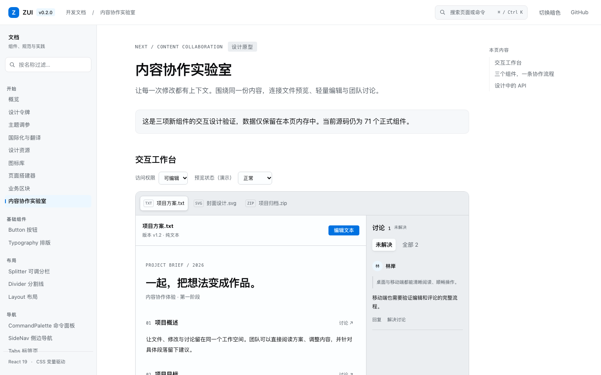

# ZUI 本地项目与文档显示审计（2026-11-09）

## 当前进度

当前开发分支为 `codex/combobox`。源码包含 71 个 UI 组件、16 个业务区块、142 个图标，Registry 共 87 个条目；文档有 78 个公开导航路由。七个包版本仍是 `0.2.0`，源码数量不代表已发布数量。此前已同步 GitHub 并发布 Pages；npm 按用户最新指示延期。后续新增 10 个设计原型的本地实现与最新 79 条回归见[组件创意工坊记录](ui-design-lab-2026-11-09.md)，以下保留原 77 页审计与发布记录。

Combobox / MultiCombobox、SideNav、Splitter、CommandPalette 已有实现；DataGrid 保持性能原型和 RFC 阶段。新增内容协作方向也保持设计原型阶段，不计入正式组件数。历史审计见 [2026-11-06 记录](quality-audit-2026-11-06.md)。

## 本轮修复

- 切页正文通过 deferred route 保留，目标页面准备好后再替换，避免一行加载文字与大面积空白。首次直达冷路由展示结构占位；加载提示使用状态区域，减少动态效果偏好下停止动画。
- 新页面提交后才重置滚动与聚焦标题；快速改选不提交已过期页面；Builder 布局随已显示页面切换。
- 页面入场仅调整透明度，避免 transform 改变 fixed 元素包含块。
- 组件导航分为基础组件、布局、导航、数据录入、数据展示、反馈、全局配置，加“开始”共八组。侧栏搜索和全局命令面板共享分类。
- 修正代码注释、行内代码、主题预设、区块选中项、Upload 文件大小及暗色 Affix 示例的文字对比度。
- 为 Steps、设计导入流程、Table 和 Transfer 的宽内容提供具名、可聚焦的滚动区；Anchor 示例最小宽度受容器约束。
- 修正基础 Slider 轨道在 flex 容器中缩为零宽，以及窄屏日期范围值截断。
- CommandPalette 示例改为由按钮打开，可用 Escape 关闭并返回触发器；进入文档不再立即弹出不可关闭的面板。
- Image 补查提交前已经失败的缓存图片，避免并发预渲染错过 error 事件；保留 React 19 callback ref 清理函数，切换 src 后重新尝试新来源。
- 修复 Transfer 条目同时显示原生与自绘复选框的问题。样式统一覆盖条目和全选控件，并同步选中、禁用与焦点状态；桌面与 320px 暗色的选中、禁用、键盘焦点与条目移动回归通过。
- 发布复核发现 Avatar 示例仍依赖外部图库，网络不稳定会使图片检查超时；已改用站内 SVG，并与 Card/Image 一起验证没有外部图片请求。
- 首次 GitHub Linux CI 的 320px 审计发现 Input 基础示例与国际化展示板受内容最小宽度影响发生裁切；纵向示例补充可收缩宽度约束，语言切换行允许换行，国际化展示板使用 `minmax(0, 1fr)` 网格。修复后本地完整 67 条 E2E 和四组逐页矩阵再次通过。

## 内容协作设计

入口为文档导航“内容协作实验室”（`#/collaboration`）。原型支持本地文本/图片/不支持类型、加载和失败演示、概述段落编辑、取消与保存、段落引用、按文件隔离的评论、回复、解决/重新打开，以及只读模式。桌面预览与讨论并列，窄屏上下排列。

所有数据仅保存在页面内存，刷新重置。它不是正式包导出；异步持久化、保存失败/版本冲突、失效引用、权限服务、PDF/Office 与实时协同传输尚未实现。正式契约与验收见 [RFC-006](rfcs/content-collaboration.md)。后续宽工作台、文件目录、文档画布与讨论卡片优化，以及 11 条协作检查和最新全站结果，见 [2026-11-10 界面优化记录](collaboration-ui-2026-11-10.md)。

## 验证结果与边界

| 检查                             | 结果                                                                                                                                         |
| -------------------------------- | -------------------------------------------------------------------------------------------------------------------------------------------- |
| 全仓单测                         | 1373 条通过：UI 1220、Blocks 68、i18n 37、CLI 24、Icons 7、MCP 6、Tokens 3、Docs 8。Docs 代理测试因需要监听本机端口单独补跑通过              |
| 最后受影响单测                   | Image 17 + Transfer 14，共 31 条通过                                                                                                         |
| ESLint / 全仓 TypeScript         | 通过                                                                                                                                         |
| 全仓 build / UI browser build    | 通过                                                                                                                                         |
| 七包发行检查 / 消费者 / Registry | 通过；消费者为 87 条目、251 文件、71 个 MCP 示例                                                                                             |
| 浏览器回归                       | 窄屏修复后 67 条完整 E2E 同次运行全部通过（54.5 秒）                                                                                         |
| 最后新增 Transfer 浏览器用例     | 通过，覆盖桌面浅色和 320px 暗色的重复标识、选中、禁用、焦点与移动                                                                            |
| 逐页显示矩阵                     | 77 路由 × 1440px/320px × 浅色/暗色，共 308 次页面检查通过；覆盖正文/页面溢出、示例直接子元素裁切、图片加载、Slider 宽度和文字对比度          |
| 截图复核                         | 已逐页查看四组首屏联系表，并放大复核协作原型、Slider、日期范围、Table、Transfer 等修改页面。已刷新最终 Transfer 和 Avatar 修复后的矩阵与截图 |

显示矩阵报告：[1440 浅色](audits/2026-11-09/1440-light.json)、[1440 暗色](audits/2026-11-09/1440-dark.json)、[320 浅色](audits/2026-11-09/320-light.json)、[320 暗色](audits/2026-11-09/320-dark.json)。截图来自仓库 Playwright 检查，完整截图集位于本机 `/tmp/zui-release-audit/`，该临时目录不保证长期保留。

之前因审批服务超时未能执行最后的 Transfer 复核；本次发布前已恢复终端权限并完成全部 67 条仓库 Playwright 用例。四份报告为最终修复后的结果，另保存了 [Transfer 窄屏暗色截图](audits/2026-11-09/transfer-mobile-dark.png)。浏览器连接器手动协作预览未补做，相关交互由仓库 Playwright 和截图复核覆盖。

该矩阵与首屏截图不等于所有示例、弹层、打开态、长文案和原生 200% 缩放均已人工验收。Builder 的第三方编辑器界面仍有浅色区域。VoiceOver/NVDA、真实中文输入法和跨系统快捷键继续按现有 RFC 做人工验收。

## 剩余工作

1. 内容协作先用文章维护和附件审核两个消费场景验证 API，然后正式实现 FilePreview、ContentEditor、CommentThread，接入异步状态、错误和冲突、权限及引用版本。
2. DataGrid 继续完成 RFC 中的立项前置条件；当前不扩大正式组件计数。
3. 继续补齐全部打开态、长文案、缩放、辅助技术和真实输入法人工矩阵。
4. npm 仍需使用有 `@zui` scope 发布权限的账号登录；用户选择本轮先发布 GitHub，npm 稍后继续。发布时再消费 changeset、核对版本和执行发布清单。
