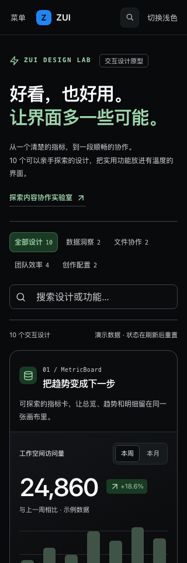

# 组件创意工坊设计与验证记录

日期：2026-11-09。入口：文档导航「开始 → 组件创意工坊」，路由 `#/lab`。

本轮完成 10 个可操作的 UI 设计原型，复用现有组件、图标和设计令牌。宽屏采用双列画廊，窄屏卡片按内部空间重排；支持浅色、暗色与减少动效。分组、关键词筛选不会清空已输入的草稿。

| 分组     | 设计                       | 可验证的功能                                            |
| -------- | -------------------------- | ------------------------------------------------------- |
| 数据洞察 | MetricBoard 数据看板       | 周/月切换、对应合计、柱状图选中详情                     |
| 数据洞察 | QueryBuilder 条件构建器    | 4 条上限、AND/OR、正反向规则、真实筛选结果              |
| 内容协作 | FileWorkbench 文件工作台   | 搜索/类型/排序、网格/列表、批量归档/撤销、文本/图片预览 |
| 内容协作 | DiffViewer 版本对比        | 并排/行内、仅变更、逐处定位、插入删除语义               |
| 团队效率 | TaskBoard 任务看板         | 创建、优先级筛选、跨列移动并保持焦点                    |
| 团队效率 | ApprovalFlow 审批流程      | 顺序审批、退回理由、重新提交、历史记录                  |
| 团队效率 | ActivityInbox 通知收件箱   | 未读/收藏筛选、详情、已读与收藏状态                     |
| 团队效率 | AccessControl 权限配置     | 成员与角色切换、权限矩阵、添加演示成员、重复校验        |
| 创作配置 | SchedulePicker 时间预约    | 日期切换、占用保护、确认/取消、锁定预约状态             |
| 创作配置 | StyleConfigurator 样式配置 | 主题色/圆角/密度、实时预览、CSS 复制、重置              |

## 验证

- 完整 Playwright 回归：79/79 通过，包含工坊的 12 条交互与显示用例。
- 全站显示审计：78 页 × 1440px/320px × 浅色/暗色，四组均无布局或对比度问题；[结构化记录](./audits/2026-11-09/ui-lab/page-audit.json)。
- 工坊额外检查：完整 axe、减少动效、页面与卡片横向溢出、键盘焦点、真实剪贴板复制，以及全部 10 个设计的四组截图。
- 补充上限边界：添加第 4 条规则使添加按钮禁用，删除后等待渲染完成，再恢复到重新启用的按钮。补查后工坊 12/12 再次通过（最终 12.3 秒）。
- 原 Splitter 拖拽测试先等待手柄位置稳定再读取坐标，消除容器宽度动画期间的定位竞争；产品实现未变。
- TypeScript、ESLint 与 GitHub Pages 模式构建通过。

## 截图

[查看全部 10 个设计总览](./audits/2026-11-09/ui-lab/designs.png)。

## 交付边界

这些是文档站中的交互设计原型，正式包仍为 71 个 UI 组件。演示数据只保存在本页内存中，刷新后恢复。通知、审批、成员和预约没有接入服务端；版本对比使用固定样例。后续包级 API、数据适配、复合组件结构与正式化要求见 [RFC 007](./rfcs/ui-design-lab.md)。本轮设计保存在本地工作区，尚未同步本次改动到 GitHub 或 npm。
